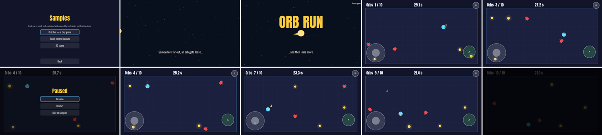

# Godot Claude Let's Go

A Godot 4.7 starter for making games **with Claude Code** that Claude can *play*. Describe a
feature; Claude builds it, plays it through real touch and controller input, records the gameplay
with sound, checks it, and hands you a page with the video and results. When you want it on your
phone, ask for an APK.



*The sample game, played and checked by Claude: 13 checks from the cutscene skip to the saved best time.*

## What you get

- **Verification on by default.** After every change a player would notice, Claude runs
  [`/verify`](.claude/skills/verify/SKILL.md). It plays the game, records it on the real renderer
  with audio, taps every button the way a finger would, and publishes a proof page with the video
  and a pass/fail for each check.
- **Cloud sessions that just work.** Godot and software rendering install themselves when a Claude
  Code session starts. This works on the default network settings, with no hosts to allow.
- **APKs without burning CI minutes.** Pushes build only when the commit message contains `[apk]`,
  plus every PR merged into `main`. Each build is a GitHub Release with a direct download link.
  There is a fallback that builds inside the session.
- **Building blocks:**
  - on-screen touch controls in five layouts (stick, d-pad, face buttons, triggers)
  - scene transitions, save/load, music and sound effects
  - video cutscenes with subtitles
  - touch-friendly menus, a pause menu and a confirm dialog
- **Samples, each with a demo Claude can replay:**
  - *Orb Run*, a 30-second game
  - an intro cutscene
  - all touch layouts
  - a 3D scene with an animated character

  Delete `samples/` when you no longer need them.
- **Android and Mac.** Android builds come from CI. On a Mac, open the project in the Godot editor
  and press Play.

## Setup

### 1. Make your copy

Click **Use this template → Create a new repository** at the top of this page. A fork works too.
Then turn on **Actions** in your new repo (Actions tab) so APK builds can run.

### 2. Open it in Claude Code

At [claude.ai/code](https://claude.ai/code), start a session on your repo. The default
environment is fine. The first session spends about two minutes installing Godot and the renderer
(you'll see *Provisioning the cloud VM…*). Then type one of the starter prompts below.

**Network:** nothing to configure. Godot, the rendering packages and the APK toolchain all
download from hosts the **Default** network policy already allows.

One exception: if you want Claude to download free CC0 art and sound itself (Kenney, Quaternius,
Poly Haven, …), add those sites to your environment's allowed hosts. The host list is in
[docs/cloud-sessions.md](docs/cloud-sessions.md#optional-let-claude-download-cc0-assets).

### 3. (Optional) Work on a Mac too

1. Install [Godot 4.7](https://godotengine.org/download/macos/) into `/Applications`.
2. Open the project: Godot → *Import* → choose this folder's `project.godot`.
3. Press ▶ to play. `./run_tests.sh` runs the tests; it finds `/Applications/Godot.app` on its own.
4. To use Claude Code locally, run `claude` in the project folder. The same `CLAUDE.md` rules apply.

Stills and video capture also work on a Mac (`tools/render.sh` and `tools/verify.sh` use your GPU;
`ffmpeg` is needed for the clips: `brew install ffmpeg`).

### 4. Make it yours

```bash
tools/rename_game.sh "Space Goats" com.yourname.spacegoats
```

This sets the game's name and Android package id. The APK is named after your repo.

## Starter prompts

Paste one into a session. Each one gets a proof page back.

> **Build a game.** Read CLAUDE.md. Replace the placeholder in scenes/game.tscn with a top-down
> game where I'm a goat collecting apples while dodging farmers. Use the stick + A touch layout,
> add music and sound effects, and show me a video of it being played.

> **Add a cutscene.** Before my game starts, play a 10-second intro cutscene with subtitles. Make
> a placeholder video the way samples/cutscene does, and show me it playing and being skipped.

> **Explore a look.** Give me three different HUD styles for my game as screenshots side by side,
> and I'll pick one.

> **Fix a bug.** When I pause and resume, the player keeps moving on its own. File an issue,
> reproduce it on video, fix it, and show me a before-and-after.

> **Get it on my phone.** Build me an APK so I can try it on my phone.

> **Start fresh.** I'm done with the samples. Remove samples/ and anything that only exists for
> them, keep the building blocks, and verify the title screen still works.

## How a change gets verified

1. Claude writes a short **demo script** that plays the real game through real input (taps, stick,
   buttons) and checks what happens. [Example](samples/sample_game/orb_run_demo.gd).
2. `tools/verify.sh` does the rest:
   - runs the tests
   - records the demo on the Mobile renderer with sound
   - makes a contact sheet (ten frames in one image)
   - profiles the audio for gaps and clicks
   - taps every button
3. Claude **looks at the contact sheet itself**, then publishes the proof page as an Artifact and
   tells you what was checked and what wasn't. A cloud machine can't judge how it *feels*; that's
   what the APK is for.

Details: [docs/verification.md](docs/verification.md).

## Getting an APK

| Way | How |
|---|---|
| Ask Claude | "Build me an APK." Claude pushes a commit with `[apk]` in the message, and GitHub posts a Release with a download link in about 5 minutes. |
| Merge a PR into `main` | Automatic. |
| By hand | Actions → *Android APK* → *Run workflow*. |
| No CI available | Claude runs `tools/android_build.sh --publish` in the session and sends a link. |

These are debug builds signed with the public Android debug key, fine for your own devices.
For Play Store releases and the Mac Android toolchain, see [docs/building-apks.md](docs/building-apks.md).

## What's in the box

| Path | What |
|---|---|
| `scenes/title_screen.tscn` | the starting point |
| `scenes/game.tscn` | placeholder for your game |
| `scripts/` | the building blocks (autoloads, UI, cutscenes) |
| `samples/` | working examples, each with a bot demo |
| `tools/` | verification, rendering, builds |
| `tests/` | GUT unit tests |
| `CLAUDE.md` | how Claude works in this repo, including the definition of done |
| `CREDITS.md` | every asset and its licence |

## Licence

MIT, see [LICENSE](LICENSE). Bundled fonts are SIL OFL, GUT is MIT, and the sample model is CC0.
Details are in [CREDITS.md](CREDITS.md).
